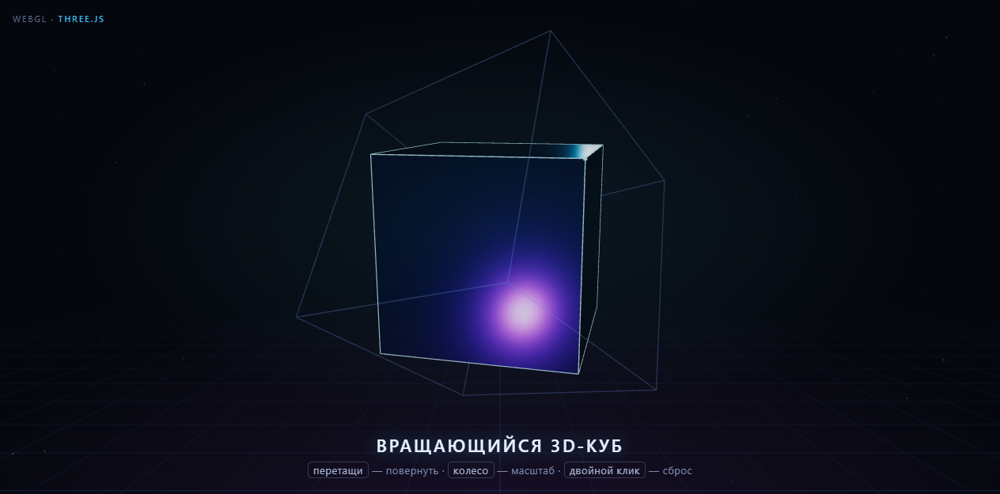

# Вращающийся 3D-куб

Интерактивный 3D-куб на WebGL (Three.js) — одна страница, без сборки и зависимостей в репозитории.

🔗 Живая демонстрация: **https://smhotey.github.io/rotating-cube/**



## Что внутри

- Гранёное тело куба с `MeshPhysicalMaterial` (metalness, clearcoat) и светящимися рёбрами
- Внешняя каркасная оболочка с «дыханием»
- Звёздное поле, перспективная сетка, fog
- Три источника света: hemisphere + направленный + два движущихся point-света (cyan / magenta)
- Управление: перетаскивание мышью/пальцем (с инерцией), щипок двумя пальцами или колесо — масштаб, двойной тап/клик — сброс
- Мобильные жесты: `touch-action: none`, отслеживание нескольких указателей, ложный сброс при щипке исключён
- Камера вписывает куб по обеим осям (`fitDistance` по вертикальному и горизонтальному FOV) — портрет, ландшафт и десктоп без обрезки
- Canvas растянут на вьюпорт явно (`width/height: 100%`): без этого при DPR>1 сцена уезжала в правый нижний угол
- Плавный возврат к автовращению после отпускания
- Пауза рендера при скрытой вкладке, уважение `prefers-reduced-motion`
- Адаптивность и `devicePixelRatio` до 2×
- Резервный CSS-3D куб, если WebGL или CDN недоступны

## Технологии

- [Three.js](https://threejs.org/) 0.160 через ESM + importmap (jsDelivr CDN)
- Чистые HTML/CSS/JS, без сборщика и npm-зависимостей

## Локальный запуск

```bash
python -m http.server 8781
# открыть http://127.0.0.1:8781
```

Открывать через `file://` тоже можно, но локальный сервер надёжнее для ES-модулей.

## Структура

```
index.html    # вся страница: разметка, стили, сцена Three.js
.nojekyll     # отключает Jekyll-обработку на GitHub Pages
```

## Лицензия

MIT
